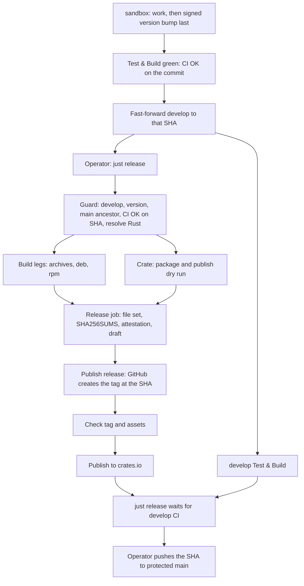
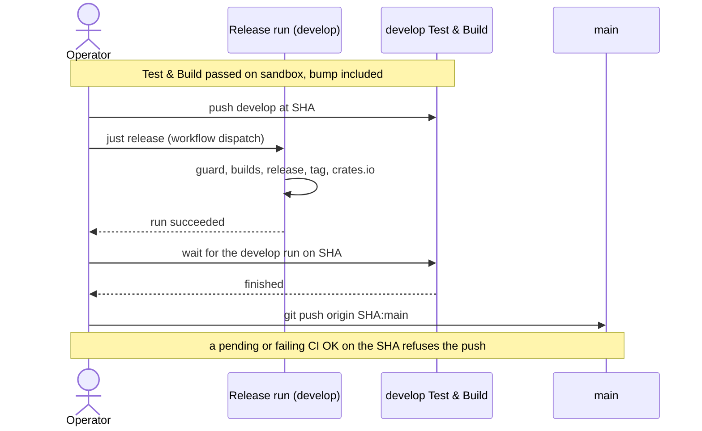
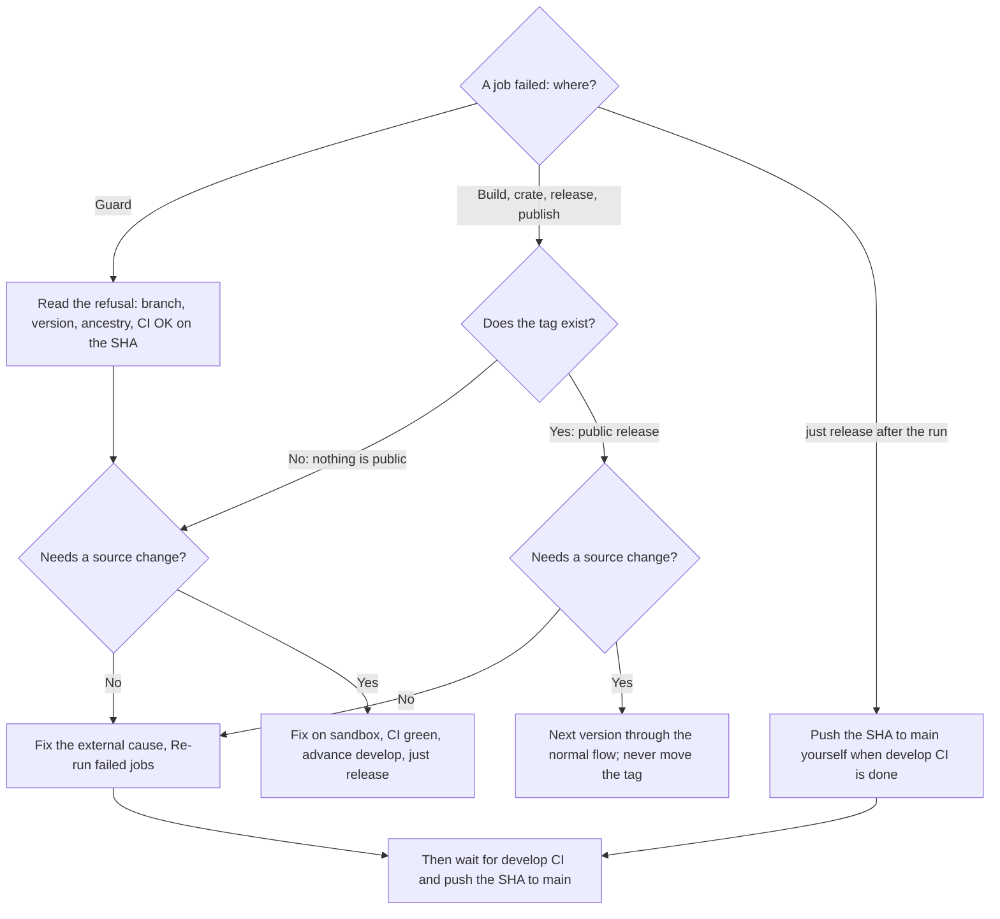

# Releasing

This project releases with one command, `just release`, and follows one rule:

> **The commit that is released is exactly the commit CI tested, and everything
> published is built from it in one workflow run.**

This repository is also the template for the other projects that use the flow (`zsmtp`,
`permesi`, `crono`). It is deliberately small: no release script, no scratch branch, no
manifest. The whole release is one workflow file,
[`release.yml`](.github/workflows/release.yml), a few small
[local actions](.github/actions) and a short `release` recipe in the
[`.justfile`](.justfile). Template-specific details (what to rename, the artifact list)
are in [`.github/TEMPLATE.md`](.github/TEMPLATE.md).

- [Release contract](#release-contract)
- [Daily release](#daily-release)
- [When something fails](#when-something-fails)
- [How the workflow is built](#how-the-workflow-is-built)
- [Adopting this flow in another project](#adopting-this-flow-in-another-project)
- [Settings](#settings)
- [Extending the release](#extending-the-release)
- [Guarantees, security and limits](#guarantees-security-and-limits)
- [Verifying a release](#verifying-a-release)
- [Why this flow](#why-this-flow)

## Release contract

1. **Exact commit.** The release builds the commit `develop` points at, and the guard
   refuses it unless the `CI OK` check succeeded on that exact SHA.
2. **Tag last.** The `X.Y.Z` tag is created by publishing the GitHub release, after every
   build succeeded. There is never a tag to delete or move.
3. **Versions only go up.** The version must be untagged and above the latest release.
4. **One compiler.** The guard resolves Rust `stable` to an exact version once; every
   Rust job of the run installs that version, and the release notes end with
   `Built with Rust X.Y.Z`.
5. **Not atomic.** The release publishes to several places (GitHub, crates.io, and in other
   projects images, Pages, Helm). Each step is safe to repeat, which is what makes a
   failure recoverable; see [When something fails](#when-something-fails).

## Daily release

Work, including dependency updates, lands on `sandbox`.

1. As the last commit of the work, the operator bumps the version with `just bump`
   (patch), `just bump-minor` or `just bump-major`. The bump covers `Cargo.toml` and
   `Cargo.lock`. The reviewer checks that it is present and right. Commits must be
   signed.
2. When **Test & Build** is green on `sandbox`, fast-forward `develop` to that same
   commit and push. `CI OK` is attached to the commit, so the run that passed on
   `sandbox` already satisfies the guard.
3. Run `just release`. It starts the Release workflow on `develop`, follows it, waits for
   `develop`'s own Test & Build run, then moves `main` to the released commit.

Keep `develop` fast-forward only. If you squash or rebase `sandbox` after its CI passed,
the commit changes and CI has to run again.



What `just release` does, in order:



The workflow never pushes `main` itself: a protected `main` refuses every update while a
`CI OK` check of the commit is pending or failing, which is exactly the state of
`develop`'s own run right after the push. The recipe identifies the run it dispatched (the
first new one for the `develop` commit, not just the latest), waits for `develop`'s
Test & Build, stops with a message if that run is missing or failed, and only then pushes
from the operator's machine.

## When something fails

Fix the cause and use **Re-run failed jobs** on the run. Every step is safe to repeat:
finished jobs are not run again, the Rust version stays the one the guard resolved, a
draft release left by a failed run is replaced, an already published release is kept (and
re-checked), and a version crates.io already has is skipped. (Re-running the whole run,
or the guard alone, resolves Rust again and fails on a version that is already tagged.)



- **Before the tag exists** nothing is public. Re-run, or fix the code, merge to
  `develop` and run `just release` again.
- **After the tag exists** the release is public, and the `release` job can still fail
  later (its last step checks the published tag and assets) as can the publish jobs.
  Transient failures are fixed by re-running. A failure that needs a code change is
  released as the next version.
- **If `just release` stopped before moving `main`**, push it yourself once
  `develop`'s Test & Build is done: `git push origin <released-sha>:main`.
- **The guard refuses** when the version is already tagged (you forgot to bump) or below
  the latest release, when `develop` does not contain `main`, when the run is not on
  `develop`, or when `CI OK` has not succeeded on the commit. The message says which.
- **CI is flaky.** Re-run the failed jobs in Test & Build until `CI OK` is green on the
  commit; the guard accepts a successful `CI OK` on it.

This was tested with injected failures: a failing build leg left no tag and no release;
a failure after the tag (the crates.io job) was fixed by re-running only that job, and
the tag was created exactly once.

## How the workflow is built

```
Release workflow (workflow_dispatch on develop)
 guard    develop only; the version is X.Y.Z, above the latest tag and untagged;
          main is an ancestor; the `CI OK` check succeeded on this exact commit;
          Rust `stable` is resolved to an exact version, used by every Rust job
 build    one leg per target, each on a native runner: the archive, and for Linux the
          .deb and .rpm (checked for version, binary and architecture); the binary is
          run once (--version must report the crate's version)
 crate    cargo package and a publish dry run; the .crate is a release file
 release  the exact file set is checked, SHA256SUMS, a build-provenance attestation,
          a draft GitHub release, then publish (this creates the tag at the tested
          commit), then a check that the tag is right and the published files, downloaded
          again, equal the built ones
 publish  crates.io (Trusted Publishing, no stored token)
```

Nothing is published before every build job has succeeded. The release notes are the
commit subjects since the previous release (version bumps left out), so no changelog is
kept by hand.

## Adopting this flow in another project

### 1. Copy and adapt

1. Copy `.github/workflows/release.yml`, `.github/actions/` and the `release` recipe
   ([below](#the-release-recipe)), along with the `bump`, `bump-minor` and `bump-major`
   recipes that make the version-bump commit.
2. Adjust the build matrix and keep the file-set check (step "Check the release files")
   in step with it: a missing or extra file stops the release, the safe failure. Remove
   the `crate` and `publish` jobs if you do not publish to crates.io.
3. Make sure your CI workflow (`build.yml` here) has the aggregate **`CI OK`** job, since
   the guard looks for it on the commit. Put the packaging and `cargo publish --dry-run`
   checks in CI too, so a problem fails on `develop` before the release. Slow or flaky
   non-gating jobs (coverage) stay out of its `needs`.
4. Make the commits that CI tests the commits that are released: `develop` only ever
   fast-forwards to a `sandbox` commit whose Test & Build passed.
5. Delete any old release script and its recipes.

Projects using this flow: this one, `zsmtp` (a crate with archives, packages and
crates.io), `permesi` (archives, Debian packages, three images, Cloudflare Pages, Helm
and docs) and `crono` (four-target binaries, packages, multi-platform images, Helm and
Pages). Look at `permesi` or `crono` when you also publish images or an OpenAPI
contract: the guard there checks the spec's version too.

### 2. Apply the settings

See [Settings](#settings) for what and why, and for the commands.

### 3. First release checklist

- [ ] Branches `sandbox`, `develop` and `main` exist; `develop` and `main` are
      protected as described below.
- [ ] **`release.yml` is on `main`.** GitHub only dispatches a workflow whose file exists
      on the default branch (`gh workflow run` answers `HTTP 404: workflow release.yml
      not found on the default branch`). A repository that never had one must put the
      workflow on `main` once, before its first `just release`, by fast-forwarding `main`
      to the first green commit (`git push origin <sha>:refs/heads/main`), then run
      `just release`. Later releases need nothing: `just release` keeps `main` current.
- [ ] `CI OK` exists as a check on `sandbox` commits (open a pull request or push and
      look at the commit's checks).
- [ ] Commits are signed and show **Verified** on GitHub.
- [ ] crates.io (if used): the crate exists, and the trusted publisher is set for the
      repository and `release.yml`.
- [ ] Any environment a job uses allows the `develop` branch.
- [ ] Bump the version as the last commit on `sandbox` with `just bump` (or
      `just bump-minor` / `just bump-major`; `Cargo.toml` and `Cargo.lock`),
      wait for Test & Build, fast-forward `develop`, run `just release`.
- [ ] Read the run: the guard resolved a Rust version, the release has exactly the
      expected files, the tag points at the commit, the notes say "Built with Rust".
- [ ] Make it fail once on purpose (a wrong file in the expected set) and use "Re-run
      failed jobs", so recovery is something you have seen.

### The release recipe

Put this in the `.justfile` (it needs `bash`, `gh` logged in and `git`):

```just
# Release develop: start the release workflow, follow it, then fast-forward main
release:
    #!/usr/bin/env bash
    set -euo pipefail
    git fetch --quiet origin develop
    sha="$(git rev-parse origin/develop)"
    last="$(gh run list --workflow release.yml --branch develop --event workflow_dispatch --limit 1 --json databaseId --jq '.[0].databaseId // 0')"
    gh workflow run release.yml --ref develop
    # The dispatched run is the first new one for this commit; never just "the latest".
    run=""
    for _ in $(seq 30); do
        run="$(gh run list --workflow release.yml --branch develop --event workflow_dispatch --limit 10 --json databaseId,headSha --jq "[.[] | select(.databaseId > ${last} and .headSha == \"${sha}\")][0].databaseId // empty")"
        [[ -z "${run}" ]] || break
        sleep 2
    done
    [[ -n "${run}" ]] || { echo "The dispatched release run did not appear." >&2; exit 1; }
    gh run watch "${run}" --exit-status
    # develop's own Test & Build must have finished, and passed, before main can move.
    ci=""
    for _ in $(seq 30); do
        ci="$(gh run list --workflow build.yml --branch develop --commit "${sha}" --limit 1 --json databaseId --jq '.[0].databaseId // empty')"
        [[ -z "${ci}" ]] || break
        sleep 2
    done
    [[ -n "${ci}" ]] || { echo "No Test & Build run of develop for ${sha}; push it to main yourself when CI OK passed." >&2; exit 1; }
    echo "Waiting for develop's Test & Build (run ${ci}) before moving main..."
    gh run watch "${ci}" --exit-status > /dev/null || { echo "Test & Build failed on ${sha}; re-run its failed jobs, then: git push origin ${sha}:refs/heads/main" >&2; exit 1; }
    git push origin "${sha}:refs/heads/main"
```

The workflow file names (`release.yml`, `build.yml`) are what the recipe looks up; rename
them here if yours differ.

## Settings

One-time repository settings the flow relies on. The commands mirror this repository's
current settings (read from the API); replace `OWNER/REPO`. They were applied unchanged to
`pulse-live/pulse`, a public repository, and worked. A private repository on GitHub's
free plan rejects the branch-protection and ruleset calls (HTTP 403, "Upgrade to GitHub
Pro or make this repository public"); the flow still runs there, but `main` and the tags
are then protected by discipline, not by GitHub, and there are no build provenance
attestations (drop that step from `release.yml`). The guard job asks for `checks: read`
to look up `CI OK`; a public repository works without it, a private one answers
`HTTP 403 Resource not accessible by integration`.

- **`main`**: protected, requires the `CI OK` check, signed commits and linear history,
  no force pushes or deletions, applies to admins. `just release` fast-forwards it from
  the operator's machine, so the operator must be allowed to push to it. Some projects
  restrict `main` to named pushers, which the workflow's token is not.

  ```sh
  gh api -X PUT repos/OWNER/REPO/branches/main/protection --input - <<'JSON'
  {
    "required_status_checks": { "strict": false, "contexts": ["CI OK"] },
    "enforce_admins": true,
    "required_pull_request_reviews": null,
    "restrictions": null,
    "required_linear_history": true,
    "allow_force_pushes": false,
    "allow_deletions": false
  }
  JSON
  gh api -X POST repos/OWNER/REPO/branches/main/protection/required_signatures
  ```

- **A tag ruleset** that lets `X.Y.Z` tags be created but never moved or deleted (the
  release creates the tag, so creation stays allowed):

  ```sh
  gh api -X POST repos/OWNER/REPO/rulesets --input - <<'JSON'
  {
    "name": "Release tags",
    "target": "tag",
    "enforcement": "active",
    "conditions": { "ref_name": { "include": ["refs/tags/[0-9]*.[0-9]*.[0-9]*"], "exclude": [] } },
    "rules": [ { "type": "update" }, { "type": "deletion" }, { "type": "non_fast_forward" } ],
    "bypass_actors": []
  }
  JSON
  ```

- **Workflow permissions**: the repository default is read-only
  (`gh api -X PUT repos/OWNER/REPO/actions/permissions/workflow -f default_workflow_permissions=read`);
  each job asks for what it needs.
- **crates.io Trusted Publishing** for the repository and the workflow file name
  `release.yml`. Keep that file name stable; it is part of the identity that signatures
  and attestations carry. crates.io configures the publisher on an existing crate, so a
  brand-new crate probably needs one first publish by hand before the workflow can take
  over (check the crates.io documentation; this has not been tried here).
- **Environments** used by a job (Pages, for example) must allow the `develop` branch,
  because the run is on `develop`.
- **Commit signing**: commits on `sandbox` and `develop` must be signed with a key GitHub
  knows as a signing key, because `main` requires verified signatures. Use a dedicated,
  registered signing key for unattended sessions (`git config gpg.format ssh`,
  `user.signingkey <public key file>`, `commit.gpgsign true`, and add the same public key
  to GitHub as a **signing key**); a forwarded agent disappears when the session ends.

Releasing needs `just`, `gh` (logged in) and a signing key.

## Extending the release

Other publications (container images and their signatures, Cloudflare Pages, a Helm
dispatch, a docs site) are jobs that run after `release`, so they ship only what the tag
points at. Guard each one with a check that this version is the highest release tag, run
right before it acts, so a re-run of an older release never rolls production back. Keep
that comparison to plain version order: tags made by the release are lightweight, and a
helper that wants annotated or signed tags ignores them.

Web builds download tools (Trunk, wasm-bindgen). Use a tool version that retries on 5xx
(Trunk 0.22 does), and no build cache in the release workflow, so nothing another run
wrote is executed.

## Guarantees, security and limits

- The released commit is the one `CI OK` succeeded on. The release job also checks that
  the tag points at it and that the published assets, downloaded again, are byte for byte
  the files that were built. The workflow's own builds are the only source of the files;
  crates.io receives a crate packaged from the same checkout (the `.crate` in the release
  is the one that was verified), not the uploaded file.
- A version above the latest release is required, so a lower or repeated version cannot
  take the Latest flag.
- The workflow is read-only by default; each job asks for the permissions it needs, and
  no checkout keeps the token.
- Remote actions are pinned by full commit SHA with the tag in a comment, and Dependabot
  proposes the updates.
- crates.io publishing uses Trusted Publishing: a short-lived OIDC token, no stored secret.
- Build provenance is attested for every release file.
- **Limits.** The tag is created by GitHub and is **not signed**. The release builds
  again rather than reusing CI's artifacts, so it relies on builds being repeatable
  (the same Rust version, `--locked`, no release-time caches; it does not promise
  byte-identical files). Coverage does not gate a release; a fixable image vulnerability
  is fixed in CI (a newer base or `apk upgrade`), not in the release.
- Lessons that shaped this: the guard checks the `CI OK` check on the commit, not the
  workflow run, and treats the check-runs API's `422 No commit found` right after a push
  as "not yet"; a pending `CI OK` blocks every update of a protected `main`, for the
  workflow token and the operator alike; one workflow file is easier to review and repair
  than a script plus a second mode plus a manifest.

## Verifying a release

```sh
sha256sum --check --ignore-missing SHA256SUMS
gh attestation verify <file> --repo nbari/cron-when --signer-workflow nbari/cron-when/.github/workflows/release.yml
```

The release notes also say which Rust version built the files.

## Why this flow

The usual routine is to bump the version by hand, commit, tag, push the tag and let CI
build and publish. It fails in ways that are hard to undo: the tag exists before anyone
knows the packages build, the crate can be on crates.io while the binaries are not, and
`main` holds a bump for a release that never happened.

This repository's first answer was a long script that staged the bump on a scratch
`release` branch, waited for CI and a "candidate" run, then moved `develop`, `main` and a
signed tag in one push, and published from a manifest. It worked, but it became the
problem it set out to solve: over a thousand lines of shell, a second workflow mode, a
manifest to keep in step with the build jobs, and recovery rules for each half-finished
state. The flow above keeps the guarantee and drops the machinery: the operator makes the
bump as an ordinary commit that CI tests like any other change, and the release only
builds, packages and publishes it.
