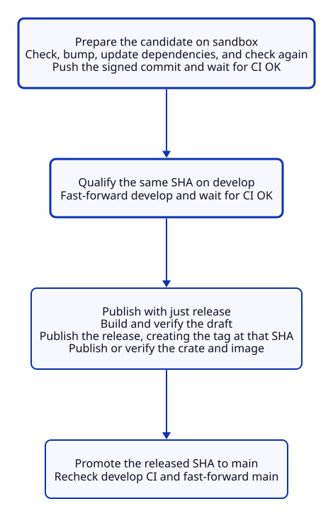
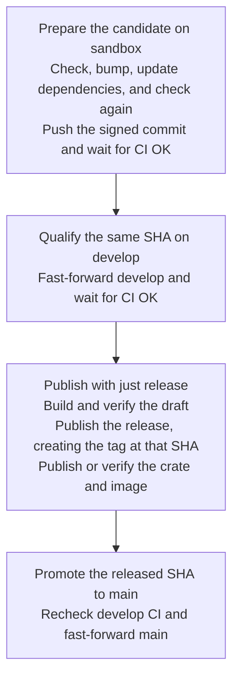
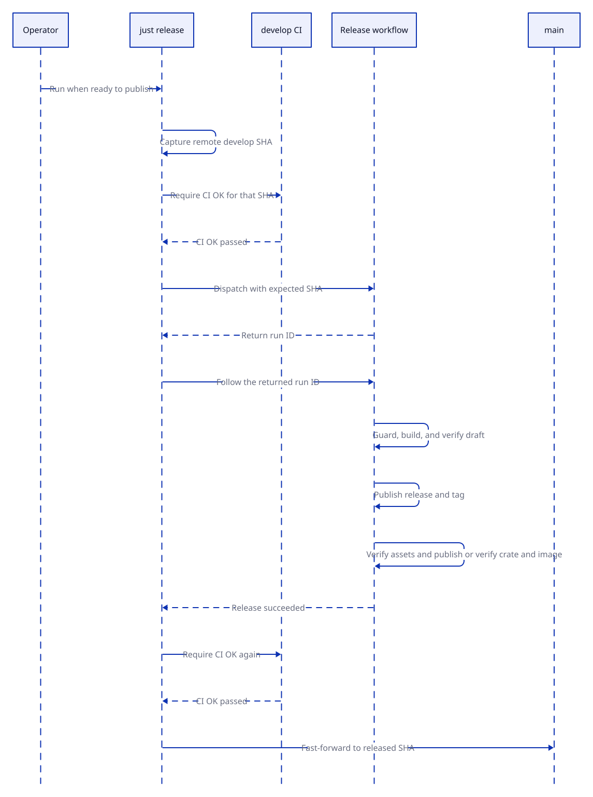
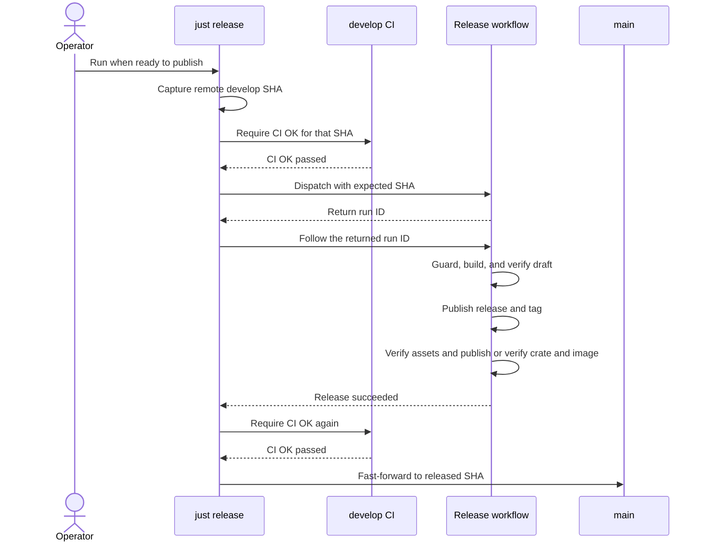
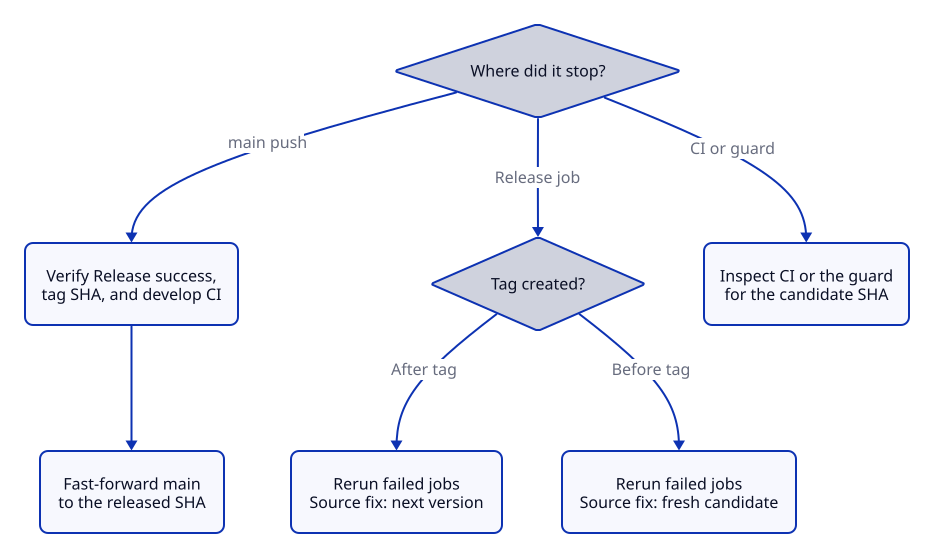
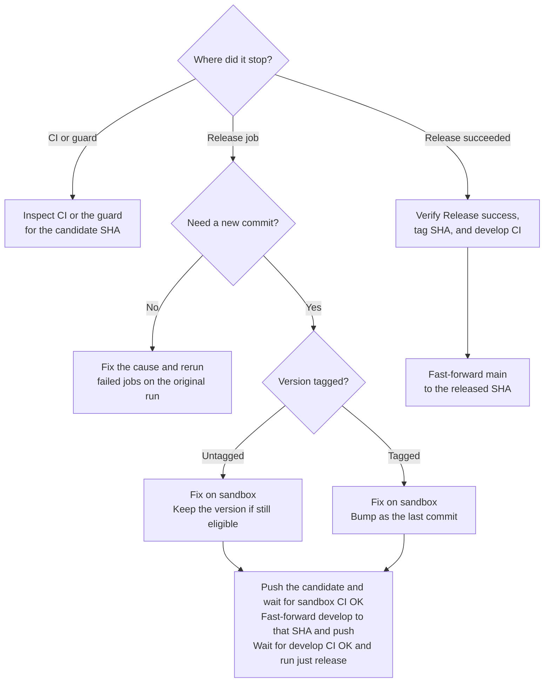

# Releasing

Prepare the version on `sandbox`, promote the same commit to `develop`, and
choose when to publish with `just release`. GitHub creates the version tag when
the verified draft is published.

## Prepare and publish

Install Bash, Git, Just, jq, Cargo Edit (`cargo set-version`), and the GitHub CLI.
Authenticate `gh` for the release repository and configure a Git signing key
that GitHub recognizes. The `origin` fetch and push URLs must identify that same
GitHub.com repository.

1. Make the bump the last commit on `sandbox` when preparing a new version.

   ```sh
   git switch sandbox
   just bump                 # patch
   # just bump-minor         # minor
   # just bump-major         # major
   candidate=$(git rev-parse HEAD)
   git push origin "$candidate:refs/heads/sandbox"
   ```

   The bump first runs `just test` (Clippy, formatting checks, and unit tests)
   to verify the starting checkout. `cargo set-version` advances the release
   version, which the recipe checks against the existing tags. `cargo update`
   then resolves dependencies within the manifest's constraints and refreshes
   `Cargo.lock`. A second `just test` checks the updated candidate before the
   recipe commits the version files in one signed local commit. CI tests that
   same dependency snapshot.

2. Wait for Test & Build's **CI OK** on that `sandbox` SHA. Fast-forward
   `develop` to it.

   ```sh
   git push origin "$candidate:refs/heads/develop"
   ```

   Use the same full SHA if you resume in another shell. The regular push
   rejects a non-fast-forward update. A rebase or squash creates a new SHA
   that needs its own CI.

3. Wait for **CI OK** on the `develop` push. When you are ready to publish, run
   `just release`. It captures the remote `develop` SHA, checks the gate, and
   follows the workflow run returned by GitHub. Optional coverage can finish
   independently. After the Release run succeeds, the recipe checks the gate
   again and fast-forwards `main` to the released SHA.



[D2 source](.github/diagrams/releasing/overview.d2)

<details>
<summary>Mermaid version</summary>



</details>

### What `just release` does

The [Release workflow](.github/workflows/release.yml) builds the archives, Linux
packages, and crate using one resolved Rust version. It checks the file set,
writes `SHA256SUMS`, and attests the build. Before publishing the draft it
checks the uploaded asset digests, the latest stable tag, and the crates.io
checksum if the version already exists there. It verifies the public tag and
downloaded files, then publishes or verifies the crate on crates.io and the
multi-architecture image on GHCR. The image uses the static binaries from the
release archives. The workflow verifies both variants and attests the image
index before assigning the version tag. An existing version tag is verified
against the release binaries on retry.



[D2 source](.github/diagrams/releasing/sequence.d2)

<details>
<summary>Mermaid version</summary>



</details>

After the first stable tag, each new release must be the next patch, minor, or
major version above the highest stable tag. For example, after `0.22.4` the
allowed versions are `0.22.5`, `0.23.0`, and `1.0.0`. Releasing `0.22.6`
requires `0.22.5` to be tagged first. Both the bump recipe and the workflow
enforce this sequence.

## When something fails



[D2 source](.github/diagrams/releasing/recovery.d2)

<details>
<summary>Mermaid version</summary>



</details>

- **CI or guard refused the release.** Check the workflow link and the SHA.
  Rerun failed CI jobs on the same push run for a transient failure. A source
  fix goes through `sandbox` and a fresh CI run.
- **The failure can be fixed on the same commit.** For a transient failure or
  a publishing settings fix, choose **Re-run failed jobs** on the original
  Release run. The retry uses the same SHA. It can replace its own incomplete
  draft before tagging or finish verifying and publishing after tagging.
- **The CLI exited or the push to `main` failed.** Check Actions for the
  original run before dispatching again. If the run succeeded, including after
  a retry, verify that its SHA matches the published tag and that `develop`'s
  **CI OK** passed for that SHA. Then run
  `git push origin <released-sha>:refs/heads/main`.
- **CI fails after `main` advances.** The GitHub release, crates.io package,
  and GHCR image remain available at the released version. Rerun failed jobs
  for a transient failure. Ship any source fix in the next version.

### Fix the source and release again

1. Switch to `sandbox`, make the fix, run `just test`, and make a signed commit.
2. Keep the existing bump if that version is still untagged and eligible. If
   the version has a release tag, make the next bump the last commit on
   `sandbox`. A newer tag or unresolved crates.io checksum conflict can also
   require a different allowed version. Keep published tags in place.
3. Push `sandbox` and wait for **CI OK**. Fast-forward `develop` to that exact
   SHA and push it. Wait for `develop`'s own **CI OK**, then run `just release`
   when ready to publish.

If an earlier run left an incomplete draft for the same version, it belongs to
that run. Before starting a new run, confirm the earlier run has stopped and
remove its draft once you have verified that it is unpublished.

## Verify a download

Download the asset and `SHA256SUMS` from the release. Substitute your GitHub
repository and the downloaded asset's path in the commands below.

```sh
repo=OWNER/REPO
asset=path/to/downloaded-asset
sha256sum --check --ignore-missing SHA256SUMS
gh attestation verify "$asset" --repo "$repo" \
  --signer-workflow "$repo/.github/workflows/release.yml"
```

The release notes record the source SHA and the resolved Rust version.

To verify a container image, use the pinned OCI reference from the Release
run's summary.

```sh
repo=OWNER/REPO
image=ghcr.io/owner/repo
gh attestation verify "oci://$image@sha256:<index-digest>" --repo "$repo" \
  --signer-workflow "$repo/.github/workflows/release.yml"
```

## Adopting this flow in another project

1. For the bump commands, copy [`.justfiles/release.just`](.justfiles/release.just)
   and add `import '.justfiles/release.just'` to the project's Justfile. Provide
   a check-only `test` recipe and commit `Cargo.lock`. Run the import from the
   Cargo project, such as the Justfile under `backend/` in a monorepo. The recipe
   supports a single crate or a workspace with a shared stable version.
2. For the full release, copy the [Release workflow](.github/workflows/release.yml),
   its [local actions](.github/actions), the release helpers under
   [`.github/scripts`](.github/scripts), and the `release` entry in
   [`.justfile`](.justfile). Keep the build matrix and its expected file list
   aligned. The CI helper expects the `CI OK` job in a `build.yml` push to
   `develop`. Use the package and publish jobs that match your destinations.
   Adapt the artifact list and packaging metadata using the
   [workflow template](.github/TEMPLATE.md).
3. Apply the [repository settings](#settings) and put `release.yml` on the
   default branch before the first dispatch. For a repository adopting the
   workflow, bootstrap it by fast-forwarding `main` to the first green
   `develop` SHA that contains it. Then follow the normal flow for a fresh release
   version. Check the first release's tag, files, and registry publication.

The bump accepts named working branches and reserves `main` and `develop` by
default. To deliberately bump on `develop` in another project, export
`RELEASE_BUMP_BRANCH := "develop"` from its Justfile. `main` is always reserved.

For generated version metadata, export `RELEASE_BUMP_FILES` as a newline-separated
list of tracked files relative to the Cargo workspace. Define a
`_release-bump-metadata version` recipe that updates those files. This example
writes the version to a tracked `docs/version.txt`.

```just
export RELEASE_BUMP_FILES := "docs/version.txt"

_release-bump-metadata version:
    @printf '%s\n' {{quote(version)}} > docs/version.txt
```

Copy the [diagram assets](.github/diagrams/releasing) with this guide. When editing
a diagram, update both versions and render its SVG from the D2 source. For
example, from the diagram directory run
`d2 --layout dagre --theme 0 --dark-theme 200 --pad 24 --scale 1 overview.d2 overview.svg`.

## Settings

- **Branches.** Make `main` the default branch. Require `CI OK` from GitHub
  Actions on `main`. Require signed commits and linear history on `main` and
  `develop`, and disallow force pushes and deletions. Permit the operator to
  fast-forward both branches directly. `develop` receives the candidate and
  then runs CI.
- **Tags and releases.** Protect stable version tags from updates and
  deletion and permit the release workflow to create them. Enable GitHub
  immutable releases where available.
- **Actions.** Use read-only defaults and grant write permissions to the jobs
  that need them. Environments used by the release must allow `develop`.
  Check your GitHub plan's support for branch protection and attestations
  when adopting the template in a private repository.
- **crates.io.** Configure Trusted Publishing for this repository and
  `release.yml` on the existing crate. Keep that workflow filename stable.
  For a new crate, follow the registry's [first-publish instructions](https://crates.io/docs/trusted-publishing)
  before configuring the trusted publisher.
- **GHCR.** The image job publishes with the repository's `GITHUB_TOKEN`.
  Review the package's visibility after its first release. New packages are
  private by default. Set visibility for your consumers or grant the cluster
  pull access. See [Container registry permissions](https://docs.github.com/en/packages/working-with-a-github-packages-registry/working-with-the-container-registry).
